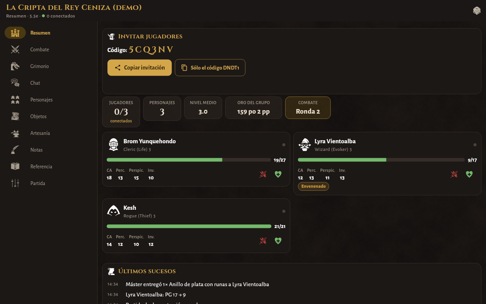
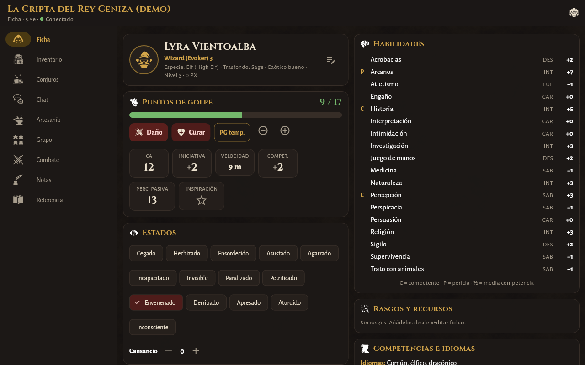
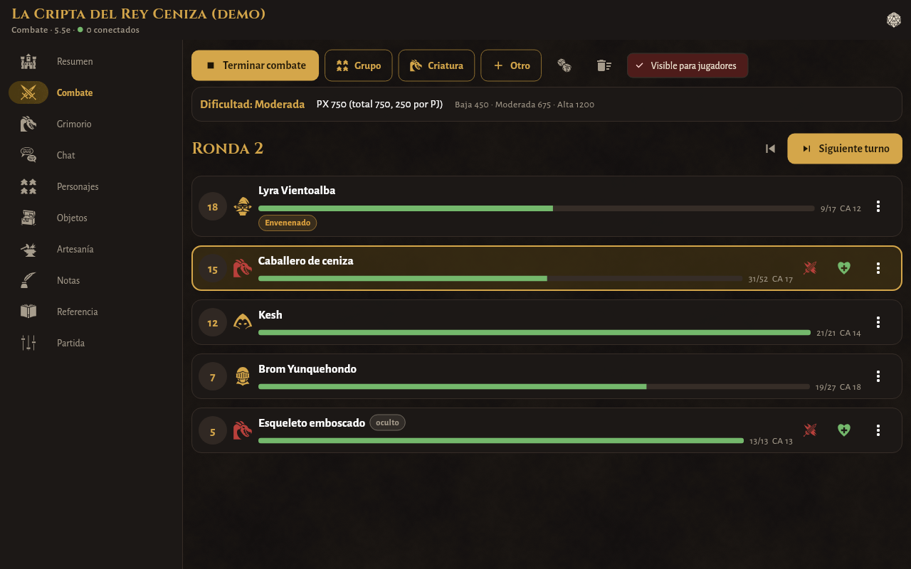
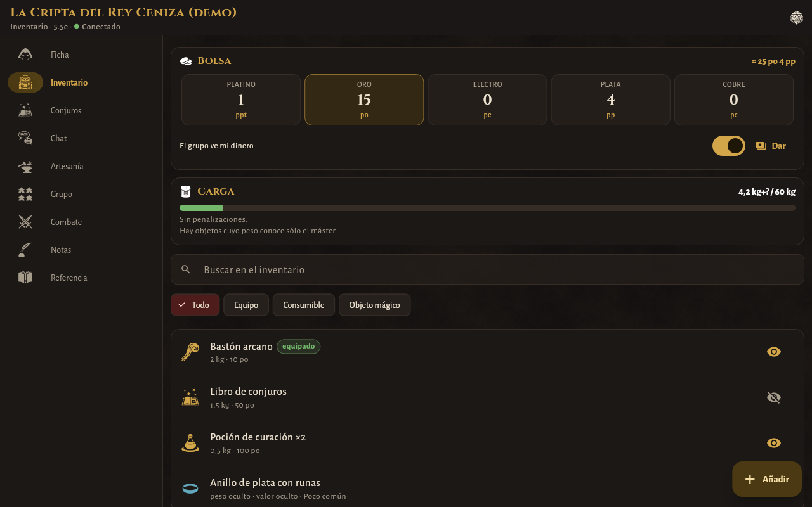
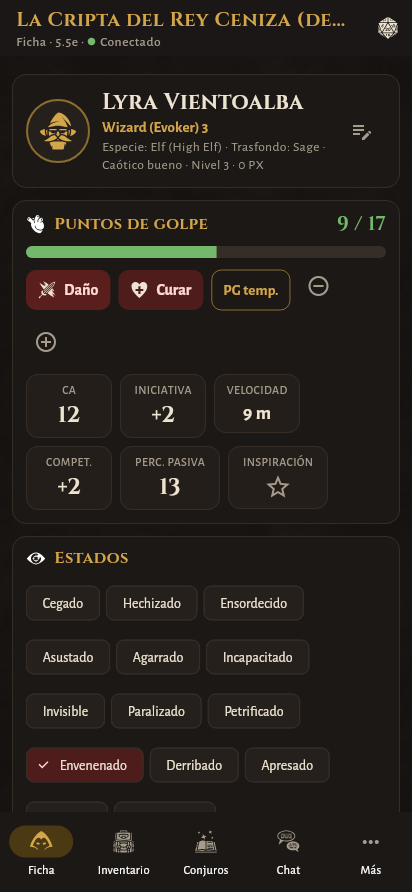
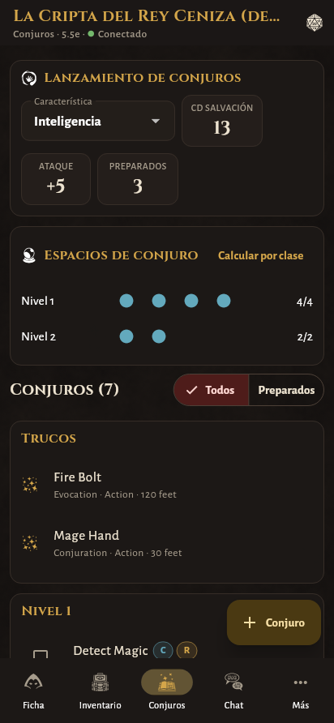
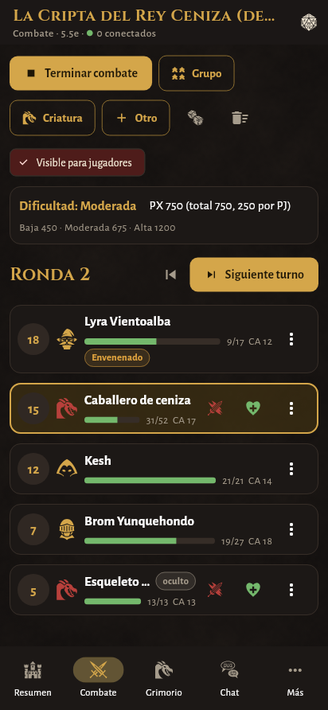

# DnD Tracker

Aplicación para llevar partidas de rol de quinta edición (**5e / 2014** y **5.5e / 2024**)
muy personalizadas. Hecha con **Flutter + Dart** para **Windows, Linux y Android**
(iOS más adelante), con tema oscuro y arte de libre uso.

Cualquier usuario puede ser **máster** en unas partidas y **jugador** en otras. El máster
crea la partida y su dispositivo hace de anfitrión: los jugadores se unen con una
invitación que se puede mandar por WhatsApp. No hace falta ningún servidor.

| Máster: resumen del grupo | Jugador: ficha |
|---|---|
|  |  |
| **Combate con dificultad del encuentro** | **Inventario con objetos ocultos por el máster** |
|  |  |

<p align="center">
  
  
  
</p>

## Qué puede hacer

### Máster
- Elegir la edición de la partida (**5e** o **5.5e**) y cambiarla después.
- **Ver todo**: fichas completas de todos los personajes, inventarios, dinero, conjuros,
  proyectos de artesanía y un **registro** de cambios (PG, oro, objetos…).
- **Grimorio**: las 334 criaturas del SRD 5.1 o las 341 del SRD 5.2 (según la edición),
  con buscador y filtros por tipo y VD, bloque de estadísticas con **tiradas al tocar**
  (ataques y daño) y **monstruos propios** (crear desde cero o copiar uno del SRD).
- **Combate**: iniciativa, turnos, rondas, PG de las criaturas, estados, criaturas
  ocultas a los jugadores y **dificultad del encuentro** con las reglas de cada edición.
- **Objetos personalizados**: biblioteca propia, entrega a uno o varios personajes,
  ocultar **peso y valor** (por objeto o en toda la partida) y notas secretas
  ("en realidad es un anillo de protección").
- **Recetas de artesanía** propias: materiales (por nombre o por etiqueta), coste, días,
  herramienta, prueba y qué personajes las conocen.
- Repartir botín y dinero, notas privadas o **compartidas** con el grupo (diario de la
  partida), invitar/expulsar jugadores, copias de seguridad.

### Jugador
- **Ficha** que se adapta a la edición: características, salvaciones, habilidades
  (competencia, pericia, media competencia), PG con daño/curación/temporales,
  salvaciones contra la muerte, estados y cansancio con su efecto según edición,
  dados de golpe, **descanso corto y largo automáticos**, rasgos con usos, ataques.
- **Inventario** con peso y valor (o "oculto" si el máster lo decide), carga, monedas,
  equipar, vincular (máx. 3), cargas, y **elegir qué objetos ve el resto del grupo**.
  Puede dar objetos y dinero a otros jugadores.
- **Conjuros**: espacios por nivel (y de pacto), cálculo automático por clase o
  multiclase, conjuros preparados con el **límite sugerido de su edición**,
  concentración, rituales y buscador del SRD filtrado por clase.
- **Artesanía**: recetas que conoce con **comprobación de materiales** ("puedes
  fabricarlo ×2" / "faltan: 1× Azufre"), fabricación según las reglas de la edición
  (en 2024, con las herramientas de artesano del SRD) y proyectos de varios días.
- **Cuaderno de notas** privado (sólo en su dispositivo) y diario compartido del máster.
- **Grupo**: compañeros, sus PG (si el máster lo permite) y los objetos que comparten.

### Para todos
- **Chat** con canal general, mensajes privados y grupos (cada jugador decide a quién
  cuenta qué).
- **Dados**: bandeja de dados (`2d6+3`, ventaja `2d20kh1`, `4d6kh3`…) y tiradas desde la
  ficha con ventaja/desventaja; se pueden compartir en el chat.
- **Referencia**: estados, conjuros, objetos, reglas (SRD 5.1) y diferencias 5e/5.5e.
- Unidades **métricas** (como los manuales en castellano) o imperiales.
- **Partida de ejemplo** para probar todo sin jugadores (botón en la pantalla de inicio).

## Red: cómo se conectan (y datos móviles)

El dispositivo del máster es el servidor. Resumen:

| Situación | Qué hacer |
|---|---|
| Misma wifi | Nada: la partida aparece sola en «Unirse» o se pega la invitación. |
| Misma mesa, sin wifi | El máster comparte datos (zona wifi) y los demás se conectan a ella. **No gasta datos.** |
| Cada uno en su casa / datos móviles | Instalad **Tailscale** (gratis). La invitación incluye la IP del máster automáticamente. |
| Sin instalar nada más | Montad el **relay** incluido (`relay/`) en cualquier servidor con IP pública. |

La explicación completa (CGNAT, seguridad, consumo, problemas habituales) está en
**[docs/RED.md](docs/RED.md)**. El relay se documenta en **[relay/README.md](relay/README.md)**.

## Compilar y ejecutar

Necesitas [Flutter](https://docs.flutter.dev/get-started/install) 3.47 o superior.

```bash
flutter pub get
```

```bash
flutter run -d linux      # o -d windows, o con un Android conectado
```

Versiones de distribución:

```bash
flutter build apk --release
```

```bash
flutter build windows --release
```

```bash
flutter build linux --release
```

Para compilar en Linux hacen falta `clang cmake ninja-build pkg-config libgtk-3-dev`.

### Tests

```bash
flutter test
```

Incluyen el motor de reglas, permisos y filtrado de datos ocultos, artesanía, una partida
real máster ↔ jugador por WebSocket (directa y a través del relay) y un recorrido por
todas las pantallas en tamaño escritorio y móvil. Para guardar capturas del recorrido:

```bash
SCREENSHOT_DIR=/tmp/capturas flutter test test/ui_tour_test.dart
```

## Estructura

```
lib/
  core/      utilidades (dados, ids, JSON)
  domain/    modelo: personaje, objeto, receta, monstruo, partida, chat, reglas por edición
  engine/    motor de la partida: comandos, permisos, vistas filtradas, artesanía
  net/       protocolo, servidor del anfitrión, relay, invitaciones, descubrimiento LAN
  data/      almacenamiento local, datos SRD, partida de ejemplo
  state/     sesiones de máster y de jugador, providers
  ui/        tema, widgets y pantallas
relay/       servidor relay opcional (Dart puro, Dockerfile)
assets/      SRD 2014/2024, iconos, fuentes, texturas
tool/        scripts para regenerar SRD, iconos y textura
docs/        documentación
```

Arquitectura en dos frases: el máster mantiene la partida completa y aplica los
**comandos** de los jugadores tras comprobar permisos (`engine/campaign_engine.dart`);
a cada jugador le envía una **vista filtrada** (`engine/view_filter.dart`) con sólo lo
que puede ver.

## Licencias y créditos

- Código: del autor del repositorio.
- Contenido de reglas: **SRD 5.1** y **SRD 5.2** de Wizards of the Coast, bajo
  [CC-BY-4.0](https://creativecommons.org/licenses/by/4.0/legalcode), vía
  [5e-bits/5e-srd-api](https://github.com/5e-bits/5e-srd-api) (MIT). Ver
  [assets/srd/LICENSE.md](assets/srd/LICENSE.md).
- Iconos: [game-icons.net](https://game-icons.net) bajo
  [CC BY 3.0](https://creativecommons.org/licenses/by/3.0/). Autores en
  [assets/icons/CREDITS.md](assets/icons/CREDITS.md).
- Tipografías: Cinzel, Cinzel Decorative y Alegreya Sans, bajo SIL Open Font License.
- Textura de fondo e icono de la app: generados con los scripts de `tool/`.

DnD Tracker es un proyecto no oficial y no está afiliado a Wizards of the Coast.

## Próximos pasos

- iOS.
- Escanear un QR con la invitación desde el móvil.
- Importar copias de seguridad desde la app (exportar ya está).
- Mantener al máster de Android como anfitrión en segundo plano (servicio en primer plano).
- Cifrado de extremo a extremo del chat privado.
- Traducción al castellano de los textos del SRD.
