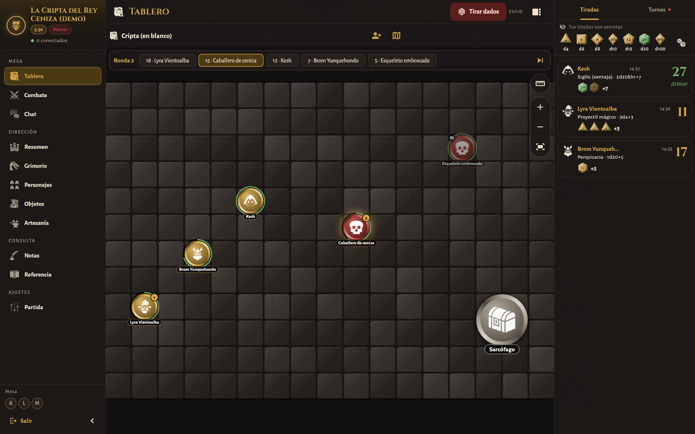
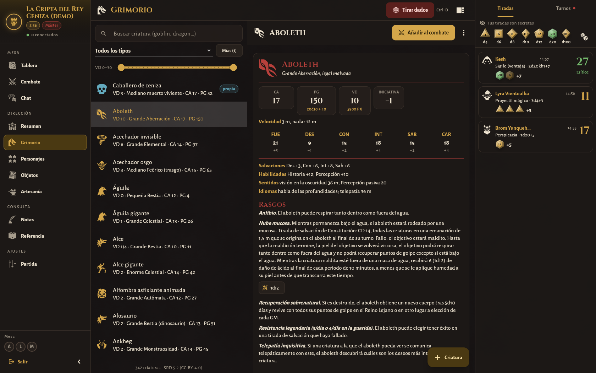
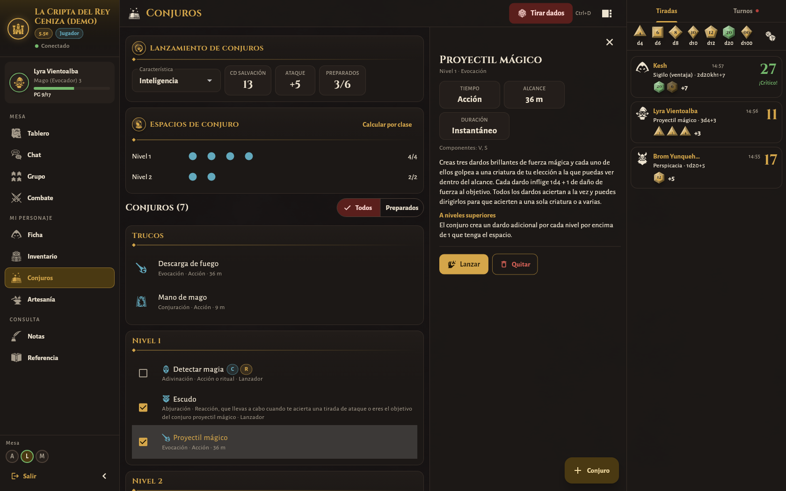
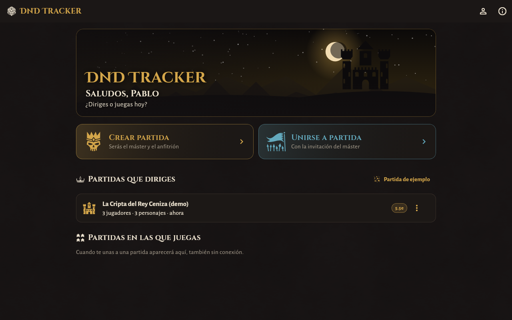
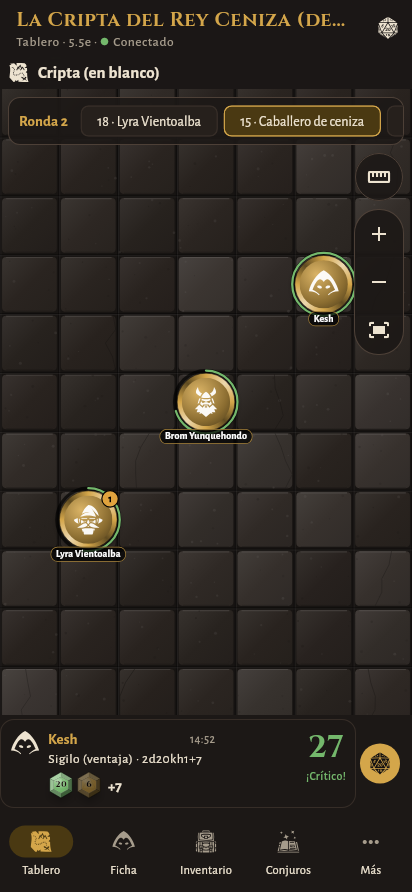
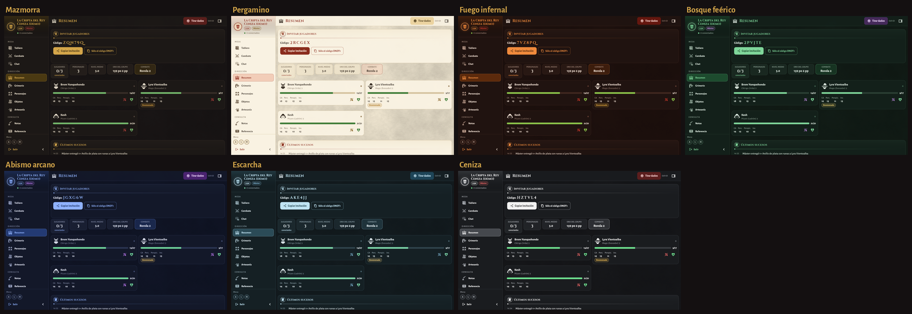

# DnD Tracker

Aplicación para llevar partidas de rol de quinta edición (**5e / 2014** y **5.5e / 2024**)
muy personalizadas. Hecha con **Flutter + Dart** para **Windows, Linux y Android**
(iOS más adelante), con **siete temas de color** y arte de libre uso. Disponible en
**castellano e inglés**, con todo el contenido de reglas (criaturas, conjuros, objetos…)
en la **traducción oficial al castellano del SRD**. Tiene una interfaz pensada para
**PC** (barra lateral, paneles divididos, tablas, atajos de teclado) y otra para
**móvil** (barra inferior, pestañas y hojas que suben desde abajo).

Cualquier usuario puede ser **máster** en unas partidas y **jugador** en otras. El máster
crea la partida y su dispositivo hace de anfitrión: los jugadores se unen con una
invitación que se puede mandar por WhatsApp. No hace falta ningún servidor. Hasta
**8 jugadores** por partida.



| Máster: combate con el bloque de quien tiene el turno | Máster: grimorio en castellano |
|---|---|
|  |  |
| **Jugador: ficha en columnas** | **Jugador: inventario en tabla con detalle** |
|  |  |
| **Jugador: conjuros con detalle** | **Pantalla de inicio** |
|  |  |

<p align="center">
  
  
  
  
</p>

## Qué puede hacer

### Interfaz de PC y de móvil
- **PC** (ventana de 900 px o más): barra lateral con la partida, tu personaje y sus PG,
  las secciones agrupadas y quién está conectado; cabecera de sección; panel derecho con
  las **tiradas** y el **orden de turnos**. La ficha va en columnas como una hoja
  impresa, el inventario es una tabla con panel de detalle, los conjuros y el grimorio
  muestran el detalle al lado y en combate aparece el bloque de estadísticas de quien
  tiene el turno. Atajos: **Ctrl+1…9** (secciones), **Ctrl+D** (dados), **Ctrl+.**
  (panel derecho); en el tablero, flechas para mover la ficha elegida, **+/−** para el
  zoom y **Esc** para cancelar.
- **Móvil**: barra inferior con las cuatro secciones principales y «Más» en cuadrícula;
  la ficha con cabecera fija de PG y pestañas (Combate, Atributos, Rasgos, Historia);
  detalles en hojas que suben desde abajo.

### Temas y arte
- Siete temas: **Mazmorra**, **Pergamino** (claro), **Fuego infernal**, **Bosque
  feérico**, **Abismo arcano**, **Escarcha** y **Ceniza**. Se eligen al empezar y en
  *Perfil → Apariencia*.
- 250 iconos de game-icons.net: cada criatura, objeto, conjuro (por escuela) y estado
  del SRD tiene el suyo; retratos por clase y especie.
- Dados en relieve, fichas del tablero tipo moneda, baldosas de piedra en los mapas en
  blanco y una ilustración de cabecera, todo dibujado por código.
- **Tus propias imágenes**: retrato del personaje, imagen de cada ficha del mapa y los
  mapas. Ver [«¿Y el arte oficial?»](#y-el-arte-oficial).



### Tablero de juego
La primera pantalla de la partida es el **tablero**, como una mesa real:
- **Tiradas a la vista**: cada jugador tira sus propios dados y **todos ven el resultado**
  al momento, con una animación de dados rodando. Los dados se tiran en el dispositivo
  del máster (anfitrión), así nadie puede inventarse el resultado. Las tiradas del
  **máster son secretas**: los jugadores no las ven.
- **Mapa con cuadrícula**: el máster sube una imagen (con o sin cuadrícula dibujada,
  hasta 4096 px) y ajusta la rejilla, o crea un tablero en blanco de baldosas. Cada
  casilla mide **5 pies (1,5 m)** en ambas ediciones; las diagonales cuentan 1 casilla o
  alternan 5/10 pies (variante), según elija el máster. El mapa se abre con **casillas
  grandes** (64 px en PC, 52 en móvil) encuadrando las fichas, y tiene zoom.
- **Fichas**: los personajes (con su retrato), criaturas del grimorio (con imagen PNG/JPG
  propia o icono) y marcadores (PNJ, cofres, trampas). Tamaños de 1×1 a 4×4.
- **Movimiento**: las fichas se **arrastran** (o se elige la ficha y se toca la casilla).
  Cada jugador mueve sólo a su personaje; el máster mueve a todos y puede dejarlos **en
  cualquier casilla**, también encima de otra ficha. Al añadir criaturas, marcadores o
  al grupo, el máster **toca dónde va cada una**. Se indica la distancia recorrida y hay
  una **regla** para medir alcances de conjuros.
- **Vida y estados**: los PG y estados de los personajes los ve todo el grupo. Los PG de
  los enemigos **sólo los ve el máster**; para describirlos usa **etiquetas visibles**
  («Envenenado», «Debilitado», «Se le ve cansado», o las que escriba).
- Las criaturas ocultas no aparecen en el tablero de los jugadores hasta que el máster
  las muestra.

### Máster
- Elegir la edición de la partida (**5e** o **5.5e**) y cambiarla después.
- **Ver todo**: fichas completas de todos los personajes, inventarios, dinero, conjuros,
  proyectos de artesanía y un **registro** de cambios (PG, oro, objetos…).
- **Grimorio**: las 334 criaturas del SRD 5.1 o las 341 del SRD 5.2 (según la edición),
  con buscador y filtros por tipo y VD, bloque de estadísticas con **tiradas al tocar**
  (ataques y daño) y **monstruos propios** (crear desde cero o copiar uno del SRD).
- **Combate**: iniciativa, turnos, rondas, PG de las criaturas, estados, criaturas
  ocultas a los jugadores y **dificultad del encuentro** con las reglas de cada edición.
- **Objetos personalizados**: biblioteca propia, entrega a uno o varios personajes,
  ocultar **peso y valor** (por objeto o en toda la partida) y notas secretas
  ("en realidad es un anillo de protección").
- **Recetas de artesanía** propias: materiales (por nombre o por etiqueta), coste, días,
  herramienta, prueba y qué personajes las conocen.
- Repartir botín y dinero, notas privadas o **compartidas** con el grupo (diario de la
  partida), invitar/expulsar jugadores, copias de seguridad.

### Jugador
- **Ficha** que se adapta a la edición: características, salvaciones, habilidades
  (competencia, pericia, media competencia), PG con daño/curación/temporales,
  salvaciones contra la muerte, estados y cansancio con su efecto según edición,
  dados de golpe, **descanso corto y largo automáticos**, rasgos con usos, ataques.
- **Inventario** con peso y valor (o "oculto" si el máster lo decide), carga, monedas,
  equipar, vincular (máx. 3), cargas, y **elegir qué objetos ve el resto del grupo**.
  Puede dar objetos y dinero a otros jugadores.
- **Conjuros**: espacios por nivel (y de pacto), cálculo automático por clase o
  multiclase, conjuros preparados con el **límite sugerido de su edición**,
  concentración, rituales y buscador del SRD filtrado por clase.
- **Artesanía**: recetas que conoce con **comprobación de materiales** ("puedes
  fabricarlo ×2" / "faltan: 1× Azufre"), fabricación según las reglas de la edición
  (en 2024, con las herramientas de artesano del SRD) y proyectos de varios días.
- **Cuaderno de notas** privado (sólo en su dispositivo) y diario compartido del máster.
- **Visibilidad por objeto**: cada objeto puede ser **sólo mío**, **todo el grupo** o
  **jugadores concretos** («lo ven Ana y Luis, pero no Marta»). El máster siempre lo ve todo.
- **Grupo**: compañeros, sus PG y los objetos que cada uno decide enseñarle.

### Para todos
- **Chat** con canal general, mensajes directos y grupos. **El máster puede leer todas las
  conversaciones** de la partida, aunque no participe en ellas (la app lo avisa).
- **Dados**: bandeja de dados (`2d6+3`, ventaja `2d20kh1`, `4d6kh3`…) y tiradas desde la
  ficha (pruebas, salvaciones, ataques, iniciativa) con ventaja/desventaja. Todas
  aparecen en el tablero.
- **Idioma**: castellano o inglés, se elige al empezar y se cambia en el perfil. En
  castellano, criaturas, conjuros, objetos, estados, clases, especies, dotes y reglas
  usan la **traducción oficial del SRD 5.1 y 5.2.1** (con medidas en metros). Los
  conjuros y objetos ya guardados en una ficha se ven en el idioma de cada uno.
- **Referencia**: estados, conjuros, objetos, reglas de las dos ediciones y diferencias
  5e/5.5e. Las búsquedas no distinguen tildes («dragon» encuentra «Dragón»).
- Unidades **métricas** (como los manuales en castellano) o imperiales.
- **Partida de ejemplo** para probar todo sin jugadores (botón en la pantalla de inicio).

## ¿Y el arte oficial?

Las ilustraciones de los manuales de D&D (las de criaturas, portadas, mapas…) son obra de
sus ilustradores y de Wizards of the Coast, y **no tienen licencia libre**: el SRD que
usa la app es sólo texto. Incluirlas en la app sería distribuirlas sin permiso, así que
no se incluyen.

Lo que sí puedes hacer es usar **tus propias imágenes** (por ejemplo, de libros que
tengas o de packs de fichas que hayas comprado, para uso en tu mesa):
- **Retrato del personaje**: *Editar ficha → Retrato → Usar una imagen*. Se ve en la
  ficha, en la barra lateral y en su ficha del tablero.
- **Fichas del mapa**: elige una ficha → *Imagen*. Sirve para criaturas, PNJ y objetos.
- **Mapas**: *Tablero → Mapas → Nuevo mapa desde imagen*.

Las imágenes se guardan en el dispositivo del máster y se envían a los jugadores de la
partida; no se publican en ningún sitio.

## Red: cómo se conectan (y datos móviles)

El dispositivo del máster es el servidor. Resumen:

| Situación | Qué hacer |
|---|---|
| Misma wifi | Nada: la partida aparece sola en «Unirse» o se pega la invitación. |
| Misma mesa, sin wifi | El máster comparte datos (zona wifi) y los demás se conectan a ella. **No gasta datos.** |
| Cada uno en su casa / datos móviles | Instalad **Tailscale** (gratis). La invitación incluye la IP del máster automáticamente. |
| Sin instalar nada más | Montad el **relay** incluido (`relay/`) en cualquier servidor con IP pública. |

La explicación completa (CGNAT, seguridad, consumo, problemas habituales) está en
**[docs/RED.md](docs/RED.md)**. El relay se documenta en **[relay/README.md](relay/README.md)**.

## Compilar y ejecutar

Necesitas [Flutter](https://docs.flutter.dev/get-started/install) 3.44 o superior (Dart 3.12+). Comprueba tu versión con `flutter --version`.

```bash
flutter pub get
```

```bash
flutter run -d linux      # o -d windows, o con un Android conectado
```

Versiones de distribución:

```bash
flutter build apk --release
```

```bash
flutter build windows --release
```

```bash
flutter build linux --release
```

Para compilar en Linux hacen falta `clang cmake ninja-build pkg-config libgtk-3-dev`.

### Tests

```bash
flutter test
```

Incluyen el motor de reglas, permisos y filtrado de datos ocultos, artesanía, una partida
real máster ↔ jugador por WebSocket (directa y a través del relay, con tiradas y
tablero), que todos los textos tengan traducción al inglés, que todo el SRD esté en
castellano, arrastrar y colocar fichas en el tablero y un recorrido por todas las
pantallas en los dos idiomas, en tamaño escritorio y móvil, y con cada tema. Para guardar capturas del recorrido:

```bash
SCREENSHOT_DIR=/tmp/capturas flutter test test/ui_tour_test.dart
```

## Estructura

```
lib/
  core/      utilidades (dados, ids, JSON, búsqueda sin tildes, traducciones es/en)
  domain/    modelo: personaje, objeto, receta, monstruo, partida, chat, tiradas, tablero
  engine/    motor de la partida: comandos, permisos, vistas filtradas, artesanía
  net/       protocolo, servidor del anfitrión, relay, invitaciones, descubrimiento LAN
  data/      almacenamiento local, datos SRD, partida de ejemplo
  state/     sesiones de máster y de jugador, providers
  ui/        tema, widgets y pantallas
relay/       servidor relay opcional (Dart puro, Dockerfile)
assets/      SRD 2014/2024, iconos, fuentes, texturas
tool/        scripts para regenerar SRD, iconos y textura
docs/        documentación
```

Arquitectura en dos frases: el máster mantiene la partida completa y aplica los
**comandos** de los jugadores tras comprobar permisos (`engine/campaign_engine.dart`);
a cada jugador le envía una **vista filtrada** (`engine/view_filter.dart`) con sólo lo
que puede ver.

## Licencias y créditos

- Código: del autor del repositorio.
- Contenido de reglas: **SRD 5.1** y **SRD 5.2** de Wizards of the Coast, bajo
  [CC-BY-4.0](https://creativecommons.org/licenses/by/4.0/legalcode), vía
  [5e-bits/5e-srd-api](https://github.com/5e-bits/5e-srd-api) (MIT). La traducción oficial
  al castellano (SRD 5.1 y 5.2.1, CC BY 4.0) procede de
  [La Taberna de Eme](https://github.com/CarlosEmerito/latabernadeeme) (CC BY 4.0) y se
  genera con `tool/build_srd_es.py`. Ver [assets/srd/LICENSE.md](assets/srd/LICENSE.md).
- Iconos: [game-icons.net](https://game-icons.net) bajo
  [CC BY 3.0](https://creativecommons.org/licenses/by/3.0/). Autores en
  [assets/icons/CREDITS.md](assets/icons/CREDITS.md).
- Tipografías: Cinzel, Cinzel Decorative y Alegreya Sans, bajo SIL Open Font License.
- Textura de fondo e icono de la app: generados con los scripts de `tool/`. La
  ilustración de inicio, las baldosas de los mapas, los dados y las fichas se dibujan
  por código (obra propia).

DnD Tracker es un proyecto no oficial y no está afiliado a Wizards of the Coast.

## Próximos pasos

- iOS.
- Escanear un QR con la invitación desde el móvil.
- Importar copias de seguridad desde la app (exportar ya está).
- Mantener al máster de Android como anfitrión en segundo plano (servicio en primer plano).
- Niebla de guerra y líneas de visión en el tablero.
- Plantillas de área (cono, esfera, línea) para conjuros.
- Fondos ilustrados para cada tema.
